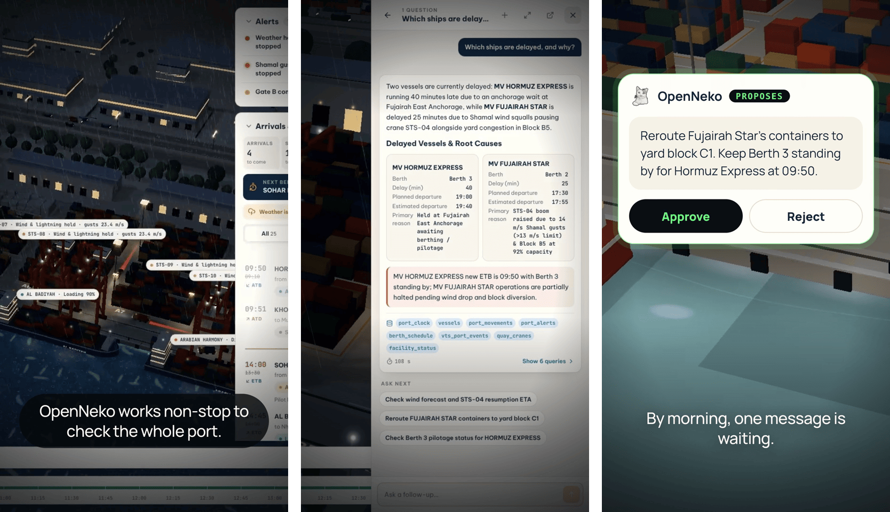

# OpenNeko

[](LICENSE)
[](https://github.com/open-neko/openneko/releases/latest)
[](INSTALL.md)
[](https://openneko.app)
[](https://github.com/open-neko/openneko/stargazers)

**OpenNeko is open-source AI for running day to day company operations. It can connect to every data system within the company. OpenNeko runs on your servers and under your control.**

Ask a question about the business and get an answer from your own data. Turn a check you repeat into a workflow that runs on a schedule. When the fix needs a change in another system, OpenNeko drafts the action and waits for your approval. You choose the LLM provider, and you can change it at any time.

[](https://fujairah.openneko.app)

The port film shows OpenNeko inside a container port at Fujairah. [See the live demo](https://fujairah.openneko.app).

## Quickstart

You need **Docker** on Linux or macOS and **one LLM provider API key**. For the [native install](INSTALL.md#run-without-docker-native) on Linux, macOS or Windows, you need PostgreSQL 16 or later instead of Docker.

```bash
curl -fsSL https://openneko.app/install.sh | sh
mkdir -p ~/openneko && cd ~/openneko
openneko setup --mode demo
```

The installer finds your OS and CPU type. It uses Homebrew on macOS and a checksum-verified release binary on Linux, and it checks for Docker. `openneko setup` runs preflight checks, starts the stack, and asks for the admin password, the data source, and the model provider and key in the terminal. To finish in a browser instead, choose **browser** at the first prompt, or pass `--skip-onboarding`, and open [http://localhost:3000](http://localhost:3000).

Without Docker, run `scripts/install-native.sh` on Linux or macOS, or `scripts/install-native.ps1` on Windows. Then run `openneko start --native` against your Postgres database. Windows runs only the native install. See [INSTALL.md](INSTALL.md#run-without-docker-native).

The demo adds four workflows that read sample data. Run **Slow-Ship Operations** from `/workflows`. Its run page under `/runs` shows a finding for orders that stay in *pending* for more than 5 days.

[INSTALL.md](INSTALL.md) has the full walkthrough: proposals and approvals, the live trial with its order simulator and scenario injector, and how to connect your own data.

To host several small customers on one VM, use named installations. Each customer gets its own Compose project, databases, secrets, files, backups, ports and Docker network. See [Multiple customer instances](INSTALL.md#multiple-customer-instances-on-one-host).

## What you get

[FEATURES.md](FEATURES.md) lists every feature and the pull request that shipped it. The main ones:

- **Answers from your data, in chat.** Ask *"Which territories drove this week's revenue drop?"* and get tables and charts, with the queries behind them. You write no SQL.
- **Workflows on a schedule or an event.** A workflow checks your data on a schedule, when a row changes, or when another system calls it. It posts what it finds, for example a SKU below its reorder point or orders stuck in *pending*.
- **Watchers in plain language.** Say *"Tell me when any SKU's on-hand stock drops below its reorder point."* OpenNeko runs the check and tells you when the condition is true.
- **Actions that wait for approval.** Slack messages, Gmail drafts and emails, Sheets updates, Shopify order notes, Magento store changes and Resend emails come with the finding that caused them. An admin approves each one, or writes a rule that lets one kind of safe action run on its own.
- **A record of every action.** OpenNeko keeps each proposal, decision and result with the finding that caused it, so you can see what ran, when, and on whose authority.

## How your data gets in

OpenNeko reads your data through **[GraphJin](https://graphjin.com)**, a GraphQL gateway that you point at the data you already have:

- **Databases.** Postgres, MySQL and [other databases](https://graphjin.com) get a generated query surface.
- **Files, external APIs and custom code.** GraphJin's script layer gives each one GraphQL fields.
- **From chat or a pack.** An admin connects a database by answering a few questions in a card. OpenNeko checks the connection, shows what the config will do, and applies it after the admin approves. For Magento, Shopify and the other systems with a pack, the card asks only for the address and the login.

The agent uses one query surface for all of it, so you write no connector code.

By default, OpenNeko only reads your databases. A change goes to another system through its API, as an action that an admin approves.

## What stays yours

The model is a part you can change. The memory of how your business runs stays in your own Postgres, on your own servers:

- **Findings.** Every workflow and watcher run, with what it found.
- **Memories and learned rules.** Facts that you confirmed, kept apart from what the agent proposed and nobody has decided on yet.
- **Document library.** Documents and spreadsheets that you upload, private to you. The agent searches them, reads them whole, and answers spreadsheet questions with SQL. It names the file and the page or sheet it used.
- **Approval rules.** Your rules for which actions run on their own, which wait for approval, and which are refused.
- **Decision history.** Every approval, rejection and result.

OpenNeko is Apache-2.0 and self-hosted, with one Postgres database. `openneko backup` writes one encrypted file with the database and the config. Each skill is a folder with a plain-Markdown `SKILL.md`, and your library is the files you uploaded.

## Integrations, channels and sign-in

Integrations ship as **solution packs**. A pack holds the sources, API specs, actions, workflows and skills for one application. Install one from **Admin → Settings → Solution packs** or with `openneko pack install`. See [PACKS.md](PACKS.md). The packs in this repository are Magento, Shopify, Google Workspace, Slack, Resend and Parallel web search.

- **Channels are built in.** Slack, Telegram and the HUD come with the core. A channel turns on when you save its credentials at **Admin → Settings → Channels**.
- **Sign-in is built in.** Scalekit gives enterprise SSO and directory sync for Okta, Entra ID, Google Workspace and other identity providers. Turn it on at **Admin → Settings → Single sign-on**. For small teams, email-link sign-in is simpler.
- **The model never sees a secret.** Channel, sign-in and pack credentials stay in the encrypted secrets store.

## Under the hood

- **Linux, macOS and Windows.** One binary and one `start` command. Linux and macOS run the Docker stack or the native install. Windows runs the native install. The systemd server install is for Linux.
- **A mobile web app.** Add OpenNeko to the Home Screen of a phone. Pair a device with an 8-letter code at `/device`, sign high-risk approvals with a passkey, and get encrypted push notifications when an approval waits, a run finishes, or a workflow needs attention.
- **Any LLM provider.** The Ax agent runs with Anthropic, OpenAI, Google, Ollama and other compatible providers. You can change the provider without a change to the agent.
- **A confined agent.** `openneko serve` runs each agent turn in a confined runner, apart from the control plane. The runner reaches data only through the per-run tool bridge of `openneko web`. Terminal commands run only in the optional sandbox service, which holds no secrets. See [AGENT_RUNTIME.md](AGENT_RUNTIME.md).
- **Optional services by URL.** An embedding service (search by meaning), a sandbox service (the terminal and the document skills) and a trace collector each connect by URL. OpenNeko works with each one off.
- **Apache-2.0.** Read the source, self-host it, fork it, and build on it. The OpenNeko trademarks have separate rules. See [LICENSING.md](LICENSING.md) and [TRADEMARKS.md](TRADEMARKS.md).

## Evaluations

OpenNeko tests the agent through the same runtime that runs in production. The suite covers skills, memories, file search, workflows, approved actions, channel delivery, compaction and GraphJin tools, against a frozen AdventureWorks snapshot.

The results in [evals/results](evals/results) come from earlier releases, on an agent backend that OpenNeko no longer ships. A results table returns here when a run of the current Ax runtime is checked in.

[Method](evals/README.md) · [Benchmark contract](evals/BACKEND-BENCHMARK.md) · [Contribution guide](evals/CONTRIBUTING.md)

## Stack modes

`openneko start|setup|upgrade --mode prod|dev|demo` selects the Compose layers that the CLI deploys. Every mode has the same core: migrations, `openneko web` and `openneko serve`. In prod mode, OpenNeko's own database is your Postgres, by URL. Dev and demo modes run it in a container.

| Mode | Layers on top of the core | What is different |
|------|---------------------------|-------------------|
| **prod** (default) | none | Only the core stack, with your Postgres as OpenNeko's database. You connect your own data source, and actions run for real. |
| **demo** | OpenNeko's database in a container, the AdventureWorks sample database, a seed job, an order simulator and a scenario injector | GraphJin reads the sample data. `openneko setup --mode demo` gives you this mode. |
| **dev** | OpenNeko's database in a container | For work on OpenNeko itself. Docker runs the services, and `openneko web` and `openneko serve` run on the host (`pnpm dev:setup && pnpm dev`, with the root `compose.yml`). See [CONTRIBUTING.md](CONTRIBUTING.md). |

A **solution pack** is not a mode. `openneko pack install magento` adds a pack to a running stack in any mode. The pack adds sources, specs and saved queries to the GraphJin config while the stack runs.

## Docs

- [INSTALL.md](INSTALL.md): install, [upgrade](INSTALL.md#upgrade), requirements, troubleshooting, connecting your data, and the full demo trial
- [FEATURES.md](FEATURES.md): every feature, with the pull request that shipped it
- [PACKS.md](PACKS.md): how to write a solution pack, its folder layout, connectors, checks and contributions
- [AGENT_RUNTIME.md](AGENT_RUNTIME.md): how the agent runs, and what `openneko web`, `openneko serve` and the sandbox service each hold
- [SECRETS.md](SECRETS.md): how the secrets file keeps secrets at rest
- [ROADMAP.md](ROADMAP.md): follow-up work, including per-request access checks
- [CONTRIBUTING.md](CONTRIBUTING.md): dev setup, repository layout and the checks to run before a PR
- [evals/README.md](evals/README.md): the eval harness, AdventureWorks baselines, resumable runs, checked-in results and production OpenTelemetry
- [CHANGELOG.md](CHANGELOG.md): releases

## Issues

File bugs and feature requests at [github.com/open-neko/openneko/issues](https://github.com/open-neko/openneko/issues).

## Contributing

Pull requests are welcome. On your first PR, a bot asks you to sign the [Contributor License Agreement](CLA.md). [CONTRIBUTING.md](CONTRIBUTING.md) has the developer setup, the repository layout, and the checks to run before you open a PR.

## License

The OpenNeko source code uses the [Apache License 2.0](LICENSE). Third-party and modular components keep their own licenses. [TRADEMARKS.md](TRADEMARKS.md) covers the OpenNeko name and logo. [LICENSING.md](LICENSING.md) has the full model.

## Author

Created by [Amit Deshmukh](https://openneko.app/#about).
